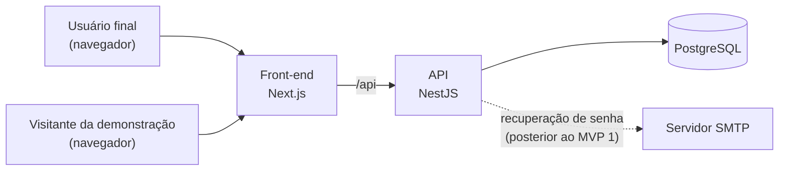

# Visão do Produto: MVP 1

| Campo     | Valor                    |
| --------- | ------------------------ |
| Projeto   | Root Book                |
| Documento | Visão do Produto (MVP 1) |
| Versão    | 0.3                      |
| Data      | 13/11/2026               |
| Autor     | Samuel                   |
| Status    | Aguardando aprovação     |

## Histórico de revisões

| Versão | Data       | Autor  | Descrição                                                                                                                                                                 |
| ------ | ---------- | ------ | ------------------------------------------------------------------------------------------------------------------------------------------------------------------------- |
| 0.1    | 12/11/2026 | Samuel | Versão inicial.                                                                                                                                                           |
| 0.2    | 12/11/2026 | Samuel | Atualização do prazo de entrega do MVP 1 para o final de janeiro de 2027.                                                                                                 |
| 0.3    | 13/11/2026 | Samuel | Revisão: horários no formato de 24 horas, durações com espaço antes de "h" e palavras estrangeiras em itálico, conforme o padrão de documentos. Pronta para congelamento. |

> **Status do conteúdo:** hipóteses não validadas.
> Este documento é entrada para a elicitação de requisitos (Fase 2) e não tem valor de especificação. Os requisitos validados constarão da Especificação de Requisitos de Software (SRS). O documento será congelado como *baseline* no *gate* da Fase 1.

---

## 1. Introdução

### 1.1 Propósito

Este documento registra o problema que o Root Book pretende resolver, o público a que se destina, o posicionamento do produto e as capacidades candidatas do MVP 1. É a referência comum dos demais documentos da Fase 1 e a principal fonte da elicitação de requisitos.

### 1.2 Escopo

O documento trata do MVP 1, primeira versão utilizável do sistema, com entrega prevista para 31/01/2027. As capacidades que não forem atribuídas ao MVP 1 permanecem registradas como candidatas a *releases* seguintes.

### 1.3 Convenções

Os identificadores seguem o [padrão de documentos](../processo/01-padrao-de-documentos.md#5-identificadores). Na seção 6, a coluna "Indicação" classifica cada capacidade como **MVP 1**, **MVP 1 (parcial)** ou **Posterior**. A indicação é uma recomendação do [estudo de viabilidade](03-estudo-de-viabilidade.md#4-viabilidade-de-cronograma) e será confirmada pela priorização MoSCoW na Fase 2.

### 1.4 Referências

- [Registro de *stakeholders*](02-registro-de-stakeholders.md)
- [Estudo de viabilidade](03-estudo-de-viabilidade.md)
- [Registro de riscos](04-registro-de-riscos.md)
- [Termo de abertura](05-termo-de-abertura.md)
- [Plano do projeto](06-plano-do-projeto.md)
- Lei nº 13.709/2018: Lei Geral de Proteção de Dados Pessoais (LGPD)
- Web Content Accessibility Guidelines (WCAG) 2.1
- RFC 5545: Internet Calendaring and Scheduling Core Object Specification (iCalendar), referência para a recorrência de eventos

---

## 2. Posicionamento

### 2.1 Oportunidade

Pessoas com rotina variada costumam registrar compromissos em um calendário e tarefas em uma lista separada. O calendário mostra o que acontece em cada horário; a lista mostra o que precisa ser feito. Nenhum dos dois indica quando cada tarefa será executada.

Hipótese a validar na Fase 2, por análise de concorrentes: a falta de um mecanismo para reservar tempo no calendário para as tarefas resulta em tarefas sem tempo reservado e em prazos perdidos.

### 2.2 Declaração do problema

|                                   |                                                                                                                                  |
| --------------------------------- | -------------------------------------------------------------------------------------------------------------------------------- |
| **O problema de**                 | registrar rotina fixa e tarefas em ferramentas separadas, sem reservar no calendário o tempo necessário para executar as tarefas |
| **afeta**                         | pessoas com rotina variada que precisam conciliar compromissos fixos e tarefas com prazo, como estudantes                        |
| **cujo impacto é**                | tarefas sem tempo reservado, prazos perdidos e replanejamento manual                                                             |
| **uma solução bem-sucedida deve** | reunir eventos, tarefas e a reserva de tempo para tarefas em um só lugar e mostrar o que fazer em cada dia                       |

### 2.3 Declaração de posicionamento

|                       |                                                                                      |
| --------------------- | ------------------------------------------------------------------------------------ |
| **Para**              | pessoas que precisam conciliar rotina fixa e tarefas com prazo                       |
| **que**               | precisam decidir quando executar cada tarefa                                         |
| **o Root Book**       | é um software web de planejamento pessoal                                            |
| **que**               | reúne eventos, tarefas e blocos de tempo no mesmo calendário                         |
| **diferentemente de** | manter um calendário e uma lista de tarefas independentes                            |
| **o nosso produto**   | permite reservar tempo para uma tarefa diretamente em um horário livre do calendário |

O posicionamento será revisto após a análise de concorrentes da Fase 2.

---

## 3. *Stakeholders* e usuários

### 3.1 Resumo dos *stakeholders*

A identificação completa está no [registro de *stakeholders*](02-registro-de-stakeholders.md).

| ID     | *Stakeholder*                          |
| ------ | -------------------------------------- |
| STK-01 | Patrocinador                           |
| STK-02 | Gerente de projeto                     |
| STK-03 | Equipe técnica                         |
| STK-04 | Usuário final                          |
| STK-05 | Visitante da instância de demonstração |
| STK-06 | Autoridade reguladora (ANPD)           |
| STK-07 | Mantenedor futuro                      |
| STK-08 | Fornecedores de plataforma             |

### 3.2 Usuários

| Usuário                   | Descrição                                                                        | *Stakeholder* |
| ------------------------- | -------------------------------------------------------------------------------- | ------------- |
| Usuário final             | Pessoa que usa o sistema para planejar a própria rotina                          | STK-04        |
| Visitante da demonstração | Pessoa que avalia o produto na instância de demonstração, com a conta de exemplo | STK-05        |

### 3.3 Ambiente do usuário

- Uso por navegador, em computador e em celular.
- Uso individual: cada conta pertence a uma pessoa, e não há compartilhamento de dados entre contas.
- Acesso pela instância de demonstração ou por uma instância executada pelo próprio usuário com Docker Compose.

### 3.4 Necessidades

As necessidades são hipóteses, a validar na Fase 2.

| ID   | Necessidade                                                    | *Stakeholder*  | Capacidades     |
| ---- | -------------------------------------------------------------- | -------------- | --------------- |
| N-01 | Registrar compromissos fixos                                   | STK-04         | CAP-12 a CAP-19 |
| N-02 | Registrar tarefas com data planejada, prazo e esforço estimado | STK-04         | CAP-20 a CAP-25 |
| N-03 | Reservar tempo nos horários livres para executar as tarefas    | STK-04         | CAP-26 a CAP-39 |
| N-04 | Saber o que fazer no dia                                       | STK-04         | CAP-40 a CAP-42 |
| N-05 | Organizar os itens por áreas da vida                           | STK-04         | CAP-08 a CAP-11 |
| N-06 | Controlar os próprios dados pessoais                           | STK-04, STK-06 | CAP-05 a CAP-07 |
| N-07 | Avaliar o produto sem cadastro e sem fornecer dados pessoais   | STK-05         | CAP-54          |

---

## 4. Visão geral do produto

### 4.1 Perspectiva do produto

O Root Book é composto por um front-end web (Next.js), uma API (NestJS) e um banco de dados PostgreSQL. O front-end acessa os dados somente pela API.



### 4.2 Módulos

| Módulo                      | Objetivo                                               |
| --------------------------- | ------------------------------------------------------ |
| MOD-01 Autenticação         | Cadastro, entrada, saída e recuperação de senha        |
| MOD-02 Autorização          | Isolamento dos dados de cada usuário                   |
| MOD-03 Conta e privacidade  | Consentimento, exportação e exclusão de dados          |
| MOD-04 Organização          | Espaços e Grupos                                       |
| MOD-05 Calendário           | Visões e eventos                                       |
| MOD-06 Recorrências         | Repetição de eventos                                   |
| MOD-07 Tarefas              | Tarefas, datas, prazos e duração estimada              |
| MOD-08 Planejamento         | Paleta de comandos, blocos de tempo e modo de alocação |
| MOD-09 Visão Hoje           | O que fazer no dia                                     |
| MOD-10 Fuso horário e datas | Tratamento de horários e datas                         |
| MOD-11 Busca e filtros      | Localização de itens                                   |
| MOD-12 Lixeira              | Exclusão reversível                                    |
| MOD-13 Preferências         | Configurações do usuário                               |
| MOD-14 Validação e erros    | Regras de negócio e mensagens                          |
| MOD-15 Observabilidade      | Logs estruturados                                      |
| MOD-16 Demonstração         | Operação da instância pública de demonstração          |

### 4.3 Instância de demonstração

Instância pública para recrutadores e terceiros avaliarem o produto sem instalá-lo. Usa o mesmo código das demais instâncias, configurado com `DEMO_MODE=true`:

| Aspecto                                                  | Definição                                                                                          |
| -------------------------------------------------------- | -------------------------------------------------------------------------------------------------- |
| Hospedagem                                               | Planos gratuitos de Vercel (front-end), Render (API) e Neon (banco), a confirmar por ADR na Fase 3 |
| Dados                                                    | Fictícios, em uma conta de exemplo, reiniciados diariamente                                        |
| Cadastro                                                 | Desativado                                                                                         |
| Recuperação de senha, troca de senha e exclusão da conta | Desativadas                                                                                        |

O plano de configuração e operação está no [plano do projeto](06-plano-do-projeto.md#9-instância-de-demonstração).

### 4.4 Execução com Docker Compose

O projeto pode ser executado por qualquer pessoa com Docker Compose, localmente ou em um servidor, com `DEMO_MODE=false`. As instruções de execução fazem parte da *release* 1.0.0.

### 4.5 Licenciamento

O código é distribuído sob a licença MIT. A escolha mantém o código aberto e não impõe obrigações a quem quiser avaliar, executar ou reutilizar o projeto, o que atende à finalidade de portfólio.

### 4.6 Premissas e dependências

- O uso é individual.
- O sistema mostra os horários livres; quem decide onde reservar tempo é o usuário.
- Grupos têm um único nível.
- A paleta de comandos é aberta a partir de uma seleção no calendário.
- A instância de demonstração depende da manutenção dos planos gratuitos dos fornecedores (RSK-06).

---

## 5. Conceitos

### 5.1 Hierarquia

```text
Usuário
└── Espaço            (grande área da vida: "Faculdade", "Saúde", "Casa")
    ├── Grupo         (subdivisão: "Cálculo II", "Exames", "Mercado")
    │   ├── Eventos
    │   └── Tarefas
    └── Itens soltos  (eventos e tarefas direto no Espaço, sem Grupo)
```

### 5.2 Glossário

| Conceito           | Definição                                                                                                                                       |
| ------------------ | ----------------------------------------------------------------------------------------------------------------------------------------------- |
| Espaço             | Grande área da vida. Contém Grupos e itens soltos.                                                                                              |
| Grupo              | Subdivisão de um Espaço, com um único nível.                                                                                                    |
| Evento             | Algo que acontece, com data ou horário fixos. Pode ser com horário (início e fim) ou de dia inteiro, e único ou recorrente. Não tem status.     |
| Tarefa             | Algo a ser feito. Tem status (`pendente`, `em andamento`, `concluída`, `cancelada`) e, opcionalmente, data planejada, prazo e duração estimada. |
| Data planejada     | Quando o usuário pretende fazer a tarefa. Passar dela não é atraso.                                                                             |
| Prazo              | Até quando a tarefa precisa ser feita. Passar dele torna a tarefa atrasada.                                                                     |
| Duração estimada   | Quanto esforço a tarefa exige. Um valor por tarefa.                                                                                             |
| Bloco de tempo     | Intervalo no calendário ligado a uma tarefa, indicando quando o esforço será dedicado. Zero ou mais por tarefa.                                 |
| Tempo alocado      | Soma da duração dos blocos de uma tarefa, comparada à duração estimada.                                                                         |
| Recorrência        | Regra que repete um evento ao longo do tempo.                                                                                                   |
| Paleta de comandos | Menu aberto ao selecionar um horário livre, com os comandos "Reservar para tarefa…" e "Agendar evento…".                                        |
| Modo de alocação   | Etapa de criação em que o usuário monta vários blocos provisórios de uma tarefa e os confirma de uma vez.                                       |
| Modo demonstração  | Configuração (`DEMO_MODE=true`) que adapta a instância para avaliação pública.                                                                  |
| Conta de exemplo   | Conta pré-criada, com dados fictícios, usada pelos visitantes da demonstração.                                                                  |

### 5.3 Criação e edição

| Situação                                                      | Comportamento                                                                                         |
| ------------------------------------------------------------- | ----------------------------------------------------------------------------------------------------- |
| Itens em criação (intervalos provisórios do modo de alocação) | Podem ser ajustados em conjunto: distribuir o tempo entre eles ou aplicar a mesma alteração a vários. |
| Itens já criados (eventos, tarefas e blocos salvos)           | São editados um por vez: mover, redimensionar, alterar ou excluir cada item individualmente.          |

---

## 6. Capacidades

Cada capacidade é candidata a requisito. A elicitação da Fase 2 pode aceitá-la, alterá-la, adiá-la ou descartá-la, com registro na matriz de rastreabilidade.

### MOD-01: Autenticação

| ID     | Capacidade                                 | Indicação |
| ------ | ------------------------------------------ | --------- |
| CAP-01 | Cadastrar conta com e-mail e senha.        | MVP 1     |
| CAP-02 | Entrar e sair da conta.                    | MVP 1     |
| CAP-03 | Recuperar senha por e-mail.                | Posterior |
| CAP-55 | Alterar a senha, informando a senha atual. | Posterior |

### MOD-02: Autorização

| ID     | Capacidade                                                                                                  | Indicação |
| ------ | ----------------------------------------------------------------------------------------------------------- | --------- |
| CAP-04 | Permitir a cada usuário acessar apenas os próprios dados, negando qualquer acesso a dados de outro usuário. | MVP 1     |

### MOD-03: Conta e privacidade

| ID     | Capacidade                                                                                | Indicação |
| ------ | ----------------------------------------------------------------------------------------- | --------- |
| CAP-05 | Registrar, no cadastro, o consentimento com os termos de uso e a política de privacidade. | MVP 1     |
| CAP-06 | Exportar todos os dados pessoais em formato legível, como JSON.                           | Posterior |
| CAP-07 | Excluir a conta e todos os dados associados, mediante confirmação.                        | MVP 1     |

### MOD-04: Organização

| ID     | Capacidade                                                       | Indicação                                  |
| ------ | ---------------------------------------------------------------- | ------------------------------------------ |
| CAP-08 | Criar, renomear, reordenar e excluir Espaços, com cor e ícone.   | MVP 1 (parcial: criar, renomear e excluir) |
| CAP-09 | Criar, renomear, reordenar e excluir Grupos dentro de um Espaço. | Posterior                                  |
| CAP-10 | Mover um evento ou uma tarefa por vez entre Espaços e Grupos.    | Posterior                                  |
| CAP-11 | Manter eventos e tarefas soltos no Espaço, sem Grupo.            | Posterior                                  |

### MOD-05: Calendário

| ID     | Capacidade                                                                                                                                 | Indicação                                             |
| ------ | ------------------------------------------------------------------------------------------------------------------------------------------ | ----------------------------------------------------- |
| CAP-12 | Exibir as visões dia, semana e mês.                                                                                                        | MVP 1 (parcial: semana)                               |
| CAP-13 | Criar, editar e excluir eventos com horário e de dia inteiro, inclusive de vários dias, pelo formulário ou pelo comando "Agendar evento…". | MVP 1 (parcial: eventos com horário, pelo formulário) |
| CAP-14 | Exibir eventos e blocos de tempo, diferenciados visualmente.                                                                               | MVP 1                                                 |
| CAP-15 | Mover e redimensionar um evento ou bloco por vez, arrastando.                                                                              | Posterior                                             |
| CAP-16 | Sinalizar sobreposição de horários, sem bloquear.                                                                                          | Posterior                                             |

### MOD-06: Recorrências

| ID     | Capacidade                                                                                                        | Indicação |
| ------ | ----------------------------------------------------------------------------------------------------------------- | --------- |
| CAP-17 | Repetir eventos com frequência diária, semanal (com escolha dos dias), mensal ou anual, com intervalo "a cada N". | Posterior |
| CAP-18 | Encerrar a recorrência por data, por número de ocorrências ou nunca.                                              | Posterior |
| CAP-19 | Editar ou excluir uma ocorrência com escolha do alcance: só esta, esta e as seguintes, ou todas.                  | Posterior |

### MOD-07: Tarefas

| ID     | Capacidade                                                                           | Indicação |
| ------ | ------------------------------------------------------------------------------------ | --------- |
| CAP-20 | Criar, editar e excluir tarefas, com título e descrição.                             | MVP 1     |
| CAP-21 | Definir, de forma opcional e independente, data planejada, prazo e duração estimada. | MVP 1     |
| CAP-22 | Alterar o status da tarefa.                                                          | MVP 1     |
| CAP-23 | Exibir o tempo alocado em relação à duração estimada, como "2h de 4h alocadas".      | Posterior |
| CAP-24 | Marcar como atrasada a tarefa não concluída com prazo vencido.                       | Posterior |
| CAP-25 | Exibir no formulário o campo "Data" por padrão e a opção "Adicionar prazo".          | Posterior |

### MOD-08: Planejamento

| ID     | Capacidade                                                                                                                                                                                                                           | Indicação                  |
| ------ | ------------------------------------------------------------------------------------------------------------------------------------------------------------------------------------------------------------------------------------ | -------------------------- |
| CAP-26 | Selecionar um intervalo livre no calendário, arrastando; um clique simples seleciona a duração padrão de bloco.                                                                                                                      | MVP 1                      |
| CAP-27 | Abrir a paleta de comandos sobre a seleção, com os comandos "Reservar para tarefa…" e "Agendar evento…".                                                                                                                             | MVP 1                      |
| CAP-28 | Abrir o formulário de evento preenchido com o início e o fim do intervalo selecionado.                                                                                                                                               | Posterior                  |
| CAP-29 | Encontrar a tarefa por navegação (Espaço, Grupo, Tarefa) ou por busca com filtros.                                                                                                                                                   | MVP 1 (parcial: navegação) |
| CAP-30 | Criar uma tarefa nova pela paleta e reservar o intervalo para ela.                                                                                                                                                                   | Posterior                  |
| CAP-31 | Criar o bloco com exatamente o intervalo selecionado.                                                                                                                                                                                | MVP 1                      |
| CAP-32 | Quando a tarefa tem duração estimada e o intervalo não cobre o tempo restante (duração estimada menos tempo alocado), oferecer as opções cancelar ou continuar alocando. Sem duração estimada, criar o bloco sem oferecer as opções. | Posterior                  |
| CAP-33 | Incluir o intervalo original como primeiro intervalo provisório do modo de alocação.                                                                                                                                                 | Posterior                  |
| CAP-34 | Associar automaticamente à tarefa cada novo intervalo selecionado, em qualquer dia.                                                                                                                                                  | Posterior                  |
| CAP-35 | Mover, redimensionar e remover intervalos provisórios; distribuir o tempo entre eles; aplicar a mesma alteração a vários deles.                                                                                                      | Posterior                  |
| CAP-36 | Exibir o progresso da alocação em tempo real e os avisos de conflito e de prazo.                                                                                                                                                     | Posterior                  |
| CAP-37 | Ao confirmar, criar todos os blocos de uma vez; ao cancelar, descartar todos, inclusive o original.                                                                                                                                  | Posterior                  |
| CAP-38 | Editar blocos já criados um por vez: mover, redimensionar e excluir.                                                                                                                                                                 | Posterior                  |
| CAP-39 | Ao fim do horário de um bloco cuja tarefa não está concluída, marcar o bloco como "não realizado" e oferecer replanejamento; o usuário pode marcá-lo como realizado.                                                                 | Posterior                  |

### MOD-09: Visão Hoje

| ID     | Capacidade                                                                                                                                                  | Indicação |
| ------ | ----------------------------------------------------------------------------------------------------------------------------------------------------------- | --------- |
| CAP-40 | Exibir, em uma só tela, os eventos do dia, os blocos de tempo do dia, as tarefas planejadas para hoje, as tarefas atrasadas e a seção "De dias anteriores". | Posterior |
| CAP-41 | Concluir tarefas e iniciar o replanejamento a partir da visão Hoje.                                                                                         | Posterior |
| CAP-42 | Indicar tarefas com prazo entre hoje e os 3 dias seguintes que não têm tempo alocado.                                                                       | Posterior |

### MOD-10: Fuso horário e datas

| ID     | Capacidade                                                                                                                                                                          | Indicação |
| ------ | ----------------------------------------------------------------------------------------------------------------------------------------------------------------------------------- | --------- |
| CAP-43 | Armazenar horários em UTC e exibi-los no fuso do usuário.                                                                                                                           | MVP 1     |
| CAP-44 | Tratar eventos de dia inteiro, datas planejadas e prazos como datas sem fuso.                                                                                                       | Posterior |
| CAP-45 | Permitir criar um evento em outro fuso, como em uma viagem. O evento guarda o fuso de origem, é exibido no fuso atual do usuário e mostra nos detalhes o horário no fuso de origem. | Posterior |

### MOD-11: Busca e filtros

| ID     | Capacidade                                                                   | Indicação |
| ------ | ---------------------------------------------------------------------------- | --------- |
| CAP-46 | Buscar eventos e tarefas por texto no título.                                | Posterior |
| CAP-47 | Filtrar por Espaço, Grupo, status, intervalo de datas, atrasadas e sem data. | Posterior |

### MOD-12: Lixeira

| ID     | Capacidade                                                                                                                                                           | Indicação |
| ------ | -------------------------------------------------------------------------------------------------------------------------------------------------------------------- | --------- |
| CAP-48 | Enviar todo item excluído para a lixeira, inclusive ocorrências de eventos recorrentes em qualquer alcance; a exclusão de um Espaço ou Grupo envia o conteúdo junto. | Posterior |
| CAP-49 | Restaurar itens da lixeira; restaurar uma ocorrência excluída desfaz a alteração na recorrência.                                                                     | Posterior |
| CAP-50 | Apagar definitivamente os itens após 30 dias na lixeira, ou manualmente.                                                                                             | Posterior |

### MOD-13: Preferências

| ID     | Capacidade                                                                                                      | Indicação |
| ------ | --------------------------------------------------------------------------------------------------------------- | --------- |
| CAP-51 | Configurar fuso, idioma, primeiro dia da semana, formato de hora, horário disponível e duração padrão de bloco. | Posterior |

### MOD-14: Validação e erros

| ID     | Capacidade                                                               | Indicação |
| ------ | ------------------------------------------------------------------------ | --------- |
| CAP-52 | Validar as regras de negócio e retornar mensagens claras e padronizadas. | MVP 1     |

### MOD-15: Observabilidade

| ID     | Capacidade                                                                                      | Indicação |
| ------ | ----------------------------------------------------------------------------------------------- | --------- |
| CAP-53 | Registrar logs estruturados de requisições e erros, sem incluir dados pessoais em texto aberto. | MVP 1     |

### MOD-16: Demonstração

| ID     | Capacidade                                                                                                                                                                                                                                                                                                                                                                                            | Indicação |
| ------ | ----------------------------------------------------------------------------------------------------------------------------------------------------------------------------------------------------------------------------------------------------------------------------------------------------------------------------------------------------------------------------------------------------- | --------- |
| CAP-54 | Com `DEMO_MODE=true`, bloquear na API o cadastro, a recuperação de senha, a troca de senha (CAP-55) e a exclusão da conta; ocultar essas ações na interface; exibir as credenciais da conta de exemplo (e-mail do domínio `example.com`); exibir o aviso "Instância de demonstração. Os dados são reiniciados diariamente."; informar que o servidor está iniciando quando a API demorar a responder. | MVP 1     |

### 6.1 Resumo da indicação

| Indicação       | Quantidade |
| --------------- | ---------- |
| MVP 1           | 16         |
| MVP 1 (parcial) | 4          |
| Posterior       | 35         |

O MVP 1 indicado forma uma fatia vertical do fluxo principal: criar a conta, organizar os itens em Espaços, registrar eventos e tarefas e reservar um horário livre da semana para uma tarefa.

---

## 7. Regras de negócio

| ID    | Regra                                                                                                                                                                                                                                                                                                          |
| ----- | -------------------------------------------------------------------------------------------------------------------------------------------------------------------------------------------------------------------------------------------------------------------------------------------------------------- |
| RN-01 | Todo Grupo pertence a um Espaço. Todo evento e toda tarefa pertencem a um Espaço e, opcionalmente, a um Grupo desse Espaço.                                                                                                                                                                                    |
| RN-02 | Evento com horário exige início anterior ao fim. Evento de dia inteiro usa apenas datas.                                                                                                                                                                                                                       |
| RN-03 | Data planejada, prazo e duração estimada são opcionais e independentes.                                                                                                                                                                                                                                        |
| RN-04 | Apenas o prazo gera atraso.                                                                                                                                                                                                                                                                                    |
| RN-05 | Uma tarefa tem zero ou mais blocos de tempo. Concluir a tarefa não apaga blocos passados.                                                                                                                                                                                                                      |
| RN-06 | O bloco ocupa o calendário como um evento, mas pertence à tarefa.                                                                                                                                                                                                                                              |
| RN-07 | O tempo alocado pode ser menor, igual ou maior que o estimado; nenhum caso é bloqueado.                                                                                                                                                                                                                        |
| RN-08 | Enquanto a tarefa tiver blocos, a data planejada é calculada: é a data do primeiro bloco que ainda não terminou ou, se todos já terminaram, a data do último bloco. A data é recalculada sempre que um bloco é criado, movido ou excluído. Sem blocos, vale a data informada pelo usuário, que pode ser vazia. |
| RN-09 | Sobreposições e blocos depois do prazo são permitidos e sinalizados.                                                                                                                                                                                                                                           |
| RN-10 | Ajustes em conjunto valem apenas para intervalos provisórios do modo de alocação; itens já criados são editados um por vez.                                                                                                                                                                                    |
| RN-11 | Recorrência se aplica apenas a eventos.                                                                                                                                                                                                                                                                        |
| RN-12 | A partir da *release* que incluir a lixeira, nada é apagado definitivamente sem passar por ela, exceto na exclusão da conta. Antes disso, toda exclusão é definitiva e exige confirmação; a confirmação da exclusão de um Espaço informa quantos eventos e tarefas serão excluídos com ele.                    |

### 7.1 Comportamento quando as datas passam

| Situação                                                 | Comportamento                                                       |
| -------------------------------------------------------- | ------------------------------------------------------------------- |
| Data planejada passou                                    | Não é atraso; a tarefa vai para "De dias anteriores" na visão Hoje. |
| Prazo passou                                             | A tarefa fica atrasada, com destaque visual.                        |
| Bloco passou sem conclusão da tarefa                     | O bloco fica "não realizado"; o sistema oferece replanejar.         |
| Data planejada ou bloco depois do prazo                  | Permitido, com aviso.                                               |
| Prazo entre hoje e os 3 dias seguintes sem tempo alocado | Indicação na visão Hoje.                                            |

---

## 8. Fluxos

| ID    | Fluxo                                | Descrição                                                                                                                                                          | Indicação |
| ----- | ------------------------------------ | ------------------------------------------------------------------------------------------------------------------------------------------------------------------ | --------- |
| FL-01 | Montar a rotina fixa                 | Criar o Espaço "Faculdade", o Grupo "Cálculo II" e o evento recorrente "Aula" toda segunda e quarta, das 19:00 às 21:00.                                           | Posterior |
| FL-02 | Agendar um evento                    | Criar o evento "Consulta dermatologista", das 14:00 às 15:00, no Espaço "Saúde".                                                                                   | MVP 1     |
| FL-03 | Registrar evento de dia inteiro      | Criar o feriado "Proclamação da República" em 15/11.                                                                                                               | Posterior |
| FL-04 | Anotar tarefa                        | Adicionar a tarefa "Comprar café" ao Espaço "Casa", sem data.                                                                                                      | MVP 1     |
| FL-05 | Reservar tempo para uma tarefa       | Criar a tarefa "Estudar para P1", com duração estimada de 2 h; selecionar um horário livre de 2 h na semana, escolher "Reservar para tarefa…" e escolher a tarefa. | MVP 1     |
| FL-06 | Planejar uma tarefa em vários blocos | Reservar um horário de 2 h para "Estudar para P1", entrar no modo de alocação, adicionar outro intervalo de 2 h em outro dia e confirmar.                          | Posterior |
| FL-07 | Ajustar um bloco criado              | Arrastar um bloco já salvo para outro horário.                                                                                                                     | Posterior |
| FL-08 | Ver o dia                            | Abrir a visão Hoje, concluir tarefas e replanejar as pendentes.                                                                                                    | Posterior |
| FL-09 | Recuperar algo excluído              | Restaurar uma tarefa da lixeira.                                                                                                                                   | Posterior |
| FL-10 | Avaliar a demonstração               | Abrir o *link* público, aguardar a inicialização do servidor se necessário, entrar com a conta de exemplo e executar o FL-05.                                      | MVP 1     |

---

## 9. Restrições

| ID     | Restrição                                                                                                        |
| ------ | ---------------------------------------------------------------------------------------------------------------- |
| RST-01 | Front-end e API separados: toda funcionalidade é exposta pela API, e o front-end não acessa o banco diretamente. |
| RST-02 | O projeto é executado com Docker Compose, localmente ou em qualquer servidor.                                    |
| RST-03 | Orçamento zero.                                                                                                  |
| RST-04 | A instância de demonstração usa exclusivamente planos gratuitos.                                                 |
| RST-05 | Equipe de uma pessoa, sem participação de terceiros.                                                             |
| RST-06 | Stack: TypeScript, Next.js, NestJS, PostgreSQL, Prisma ORM, Testcontainers, Vitest, SWC, Zod e JWT.              |
| RST-07 | MVP 1 em execução até 31/01/2027.                                                                                |
| RST-08 | Conformidade com a LGPD.                                                                                         |

---

## 10. Requisitos de qualidade

Os métodos de medição serão definidos na Fase 2.

| ID    | Categoria      | Requisito                                                                                                                                                                                                 |
| ----- | -------------- | --------------------------------------------------------------------------------------------------------------------------------------------------------------------------------------------------------- |
| RQ-01 | Plataforma     | Aplicação web responsiva, para navegador de computador e de celular.                                                                                                                                      |
| RQ-02 | Desempenho     | A visão de calendário carrega em até 1 s para um usuário com 1 ano de eventos, com a instância ativa. O primeiro acesso após a hibernação da demonstração é tratado pelo aviso de inicialização (CAP-54). |
| RQ-03 | Segurança      | Senhas armazenadas com hash forte; tráfego somente por HTTPS; sessões com expiração.                                                                                                                      |
| RQ-04 | Privacidade    | Conformidade com a LGPD nas capacidades do MOD-03 incluídas em cada *release*.                                                                                                                            |
| RQ-05 | Acessibilidade | Navegação por teclado, inclusive na paleta de comandos, e contraste adequado, com meta de WCAG 2.1 nível AA.                                                                                              |
| RQ-06 | Idioma         | Interface em português do Brasil, preparada para outros idiomas.                                                                                                                                          |
| RQ-07 | Confiabilidade | Rotina de backup do banco disponível na execução com Docker Compose. Na demonstração não há backup: os dados são fictícios e recriados diariamente.                                                       |
| RQ-08 | Execução       | O projeto pode ser executado em ambiente limpo a partir das instruções publicadas.                                                                                                                        |

---

## 11. Fora do escopo

Itens fora do produto nesta versão do documento. A inclusão em *releases* futuras será avaliada.

- Clientes desktop e mobile nativos.
- Uso compartilhado ou colaborativo, como calendários compartilhados e convites.
- Alocação automática de tarefas pelo sistema.
- Notificações e lembretes.
- Importação, exportação ou sincronização com calendários externos.
- Funcionamento offline.
- Grupos com mais de um nível.
- Recorrência de tarefas (RN-11).
- Edição em conjunto de itens já criados (RN-10).
- Contas temporárias anônimas na instância de demonstração.

---

## 12. Roadmap

| *Release*            | Escopo                                                                               | Previsão                                        |
| -------------------- | ------------------------------------------------------------------------------------ | ----------------------------------------------- |
| MVP 1 (1.0.0)        | Capacidades indicadas como MVP 1 e MVP 1 (parcial), sujeitas à priorização da Fase 2 | 31/01/2027                                      |
| *Releases* seguintes | Capacidades indicadas como Posterior                                                 | Ciclo do MVP 2, iniciado após a *release* 1.0.0 |

A distribuição das *releases* intermediárias do MVP 1 está no [plano do projeto](06-plano-do-projeto.md#7-plano-de-releases).

---

## 13. Prioridade

A prioridade das capacidades será definida na Fase 2 pelo método MoSCoW, partindo da indicação da seção 6.
