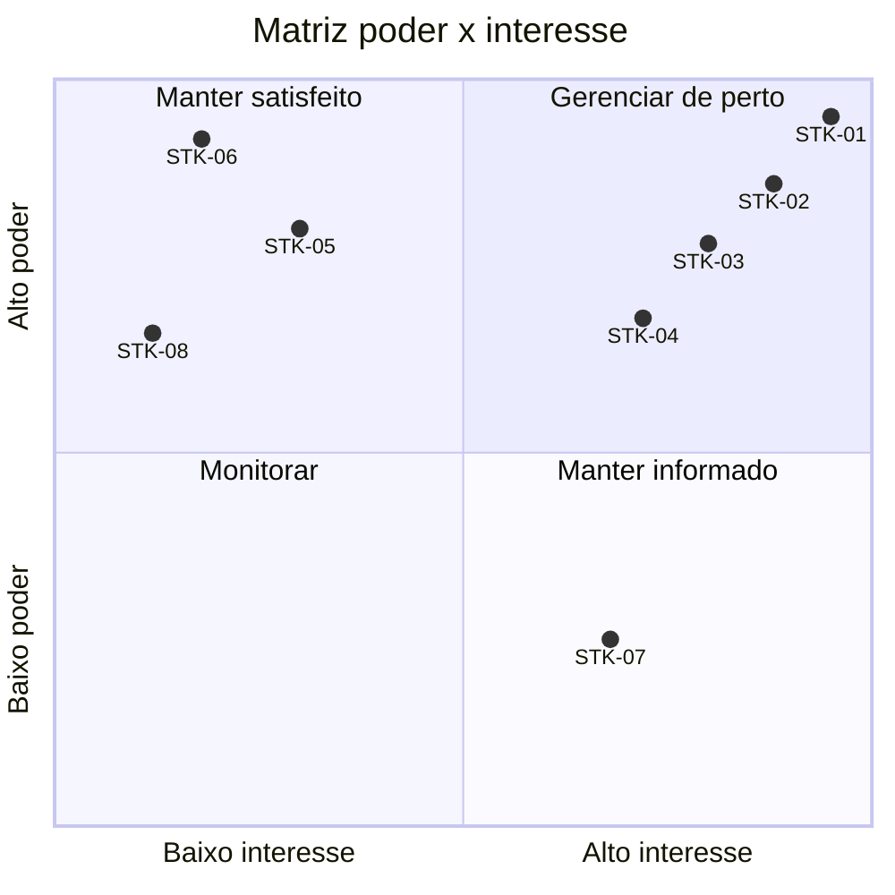

# Registro de *Stakeholders*

| Campo     | Valor                      |
| --------- | -------------------------- |
| Projeto   | Root Book                  |
| Documento | Registro de *Stakeholders* |
| Versão    | 1.0                        |
| Data      | 13/11/2026                 |
| Autor     | Samuel                     |
| Status    | Aprovado                   |

## Histórico de revisões

| Versão | Data       | Autor  | Descrição                                                                                |
| ------ | ---------- | ------ | ---------------------------------------------------------------------------------------- |
| 0.1    | 12/11/2026 | Samuel | Versão inicial.                                                                          |
| 0.2    | 12/11/2026 | Samuel | Atualização do prazo de entrega do MVP 1 para 31/01/2027 na expectativa do patrocinador. |
| 0.3    | 13/11/2026 | Samuel | Revisão: palavras estrangeiras em itálico, conforme o padrão de documentos.              |
| 1.0    | 13/11/2026 | Samuel | Aprovado no *gate* da Fase 1.                                                            |

---

## 1. Propósito

Este registro identifica as partes interessadas no Root Book, classifica-as por poder e interesse e define como as necessidades de cada uma serão levantadas e atendidas. Segue o processo "Identificar as partes interessadas" do PMBOK.

O projeto é conduzido por uma única pessoa. Vários papéis são ocupados pelo autor; mesmo assim, cada papel é registrado separadamente, porque cada um tem interesses e responsabilidades próprios. As técnicas de engajamento excluem qualquer atividade que dependa da participação de terceiros.

## 2. Identificação

| ID     | *Stakeholder*                                                       | Quem ocupa                                                                          | Interesse no projeto                                                                                         | Influência                                                       | Expectativas                                                                                                 |
| ------ | ------------------------------------------------------------------- | ----------------------------------------------------------------------------------- | ------------------------------------------------------------------------------------------------------------ | ---------------------------------------------------------------- | ------------------------------------------------------------------------------------------------------------ |
| STK-01 | Patrocinador                                                        | Samuel                                                                              | Projeto de portfólio para candidaturas a estágio em 2027.1; aprendizado do ciclo completo de desenvolvimento | Alta                                                             | MVP 1 publicado e demonstrável até 31/01/2027; documentação e código que evidenciem o processo de engenharia |
| STK-02 | Gerente de projeto                                                  | Samuel                                                                              | Cumprir escopo, prazo e custo                                                                                | Alta                                                             | Plano exequível, riscos acompanhados, marcos cumpridos                                                       |
| STK-03 | Equipe técnica (analista, arquiteto, desenvolvedor, QA e operações) | Samuel                                                                              | Entregar software correto e de qualidade                                                                     | Alta                                                             | Requisitos claros, arquitetura documentada, automação de testes e de implantação                             |
| STK-04 | Usuário final                                                       | Público-alvo: pessoas com rotina variada, como estudantes. Representado pelo autor. | Organizar rotina e tarefas                                                                                   | Alta                                                             | Registrar eventos e tarefas e reservar tempo para as tarefas no calendário                                   |
| STK-05 | Visitante da instância de demonstração                              | Recrutadores, avaliadores e terceiros                                               | Avaliar o produto e o trabalho do autor                                                                      | Alta sobre o objetivo do patrocinador; baixa sobre os requisitos | Acesso imediato, sem cadastro e sem fornecer dados pessoais; documentação clara                              |
| STK-06 | Autoridade reguladora                                               | Autoridade Nacional de Proteção de Dados (ANPD), pela LGPD                          | Proteção de dados pessoais                                                                                   | Alta (obrigatória)                                               | Conformidade com a LGPD                                                                                      |
| STK-07 | Mantenedor futuro                                                   | O autor no futuro e quem executar ou reutilizar o projeto                           | Compreender, executar e evoluir o código                                                                     | Baixa                                                            | Instruções de execução, código legível, decisões registradas em ADRs                                         |
| STK-08 | Fornecedores de plataforma                                          | Vercel, Render, Neon e GitHub                                                       | Uso dos serviços conforme termos e limites                                                                   | Alta sobre a instância de demonstração                           | Uso dentro dos limites dos planos gratuitos e dos termos de uso                                              |

## 3. Classificação

| ID     | Poder | Interesse | Quadrante          |
| ------ | ----- | --------- | ------------------ |
| STK-01 | Alto  | Alto      | Gerenciar de perto |
| STK-02 | Alto  | Alto      | Gerenciar de perto |
| STK-03 | Alto  | Alto      | Gerenciar de perto |
| STK-04 | Alto  | Alto      | Gerenciar de perto |
| STK-05 | Alto  | Baixo     | Manter satisfeito  |
| STK-06 | Alto  | Baixo     | Manter satisfeito  |
| STK-07 | Baixo | Alto      | Manter informado   |
| STK-08 | Alto  | Baixo     | Manter satisfeito  |

## 4. Estratégia de engajamento

| ID     | Como as necessidades são levantadas                                                                                         | Como o *stakeholder* é atendido ou informado                                                    | Artefatos                                                                          | Frequência               |
| ------ | --------------------------------------------------------------------------------------------------------------------------- | ----------------------------------------------------------------------------------------------- | ---------------------------------------------------------------------------------- | ------------------------ |
| STK-01 | Definição de objetivos no termo de abertura                                                                                 | Aprovação nos *gates* de fase; *sprint review*                                                  | Termo de abertura, documentos de *gate*, registros de *sprint*                     | Por fase e por *sprint*  |
| STK-02 | Acompanhamento de horas, marcos e riscos                                                                                    | Revisão do plano e do registro de riscos                                                        | Plano do projeto, registro de riscos, *devlog*                                     | Por *sprint*             |
| STK-03 | Definition of Ready e Definition of Done                                                                                    | Retrospectiva de *sprint*                                                                       | Registros de retrospectiva                                                         | Por *sprint*             |
| STK-04 | Análise de concorrentes, cenários e prototipação (Fase 2); *dogfooding* a partir da primeira *release* com tarefas e blocos | *Releases* semanais na instância de demonstração                                                | Registros em `docs/02-requisitos/elicitacao/`; *issues* com o *label* `dogfooding` | Fase 2 e a cada *sprint* |
| STK-05 | Requisitos do modo demonstração (CAP-54); avaliação heurística feita no papel de visitante antes de cada *release*          | Instância de demonstração e README da raiz                                                      | README da raiz, estudo de caso                                                     | Por *release*            |
| STK-06 | Leitura da LGPD e dos guias da ANPD na análise de domínio (Fase 2)                                                          | *Checklist* de conformidade na validação de requisitos; termos de uso e política de privacidade | *Checklist* de conformidade, termos de uso, política de privacidade                | Fase 2 e antes da 1.0.0  |
| STK-07 | Registro das decisões no momento em que são tomadas                                                                         | Instruções de execução, ADRs, descrições de PR e CHANGELOG                                      | README, ADRs, CHANGELOG                                                            | Contínua                 |
| STK-08 | Leitura dos termos de uso e das páginas de preços                                                                           | Monitoramento dos limites e das mudanças de plano (RSK-06, RSK-07)                              | Registro de riscos, *runbook*                                                      | Mensal                   |

## 5. Separação dos papéis do autor

Como o autor ocupa vários papéis, cada papel é exercido em sessões distintas e deixa um artefato verificável. Revisões são feitas em dia diferente daquele em que o item foi produzido.

| Papel                  | Atividades                                         | Momento                                      | Evidência                                                  |
| ---------------------- | -------------------------------------------------- | -------------------------------------------- | ---------------------------------------------------------- |
| Patrocinador           | Aprovar o termo de abertura e os *gates*           | Fim de cada fase                             | Documento de *gate* assinado e datado                      |
| Gerente de projeto     | Planejar e acompanhar horas, riscos e marcos       | Início e fim de cada *sprint*                | Plano, registro de riscos, *devlog*                        |
| Analista de requisitos | Elicitar, especificar e validar requisitos         | Fase 2 e refinamentos                        | SRS, histórias de usuário, matriz de rastreabilidade       |
| Arquiteto              | Decidir a estrutura técnica                        | Fase 3 e quando surgir decisão estrutural    | ADRs, diagramas C4, contrato OpenAPI                       |
| Desenvolvedor          | Implementar as histórias                           | Durante a *sprint*                           | *Commits* e PRs                                            |
| Revisor                | Revisar o PR com *checklist*                       | Dia útil seguinte à abertura do PR           | Comentários no PR                                          |
| QA                     | Projetar e executar testes e sessões exploratórias | Sessões separadas do desenvolvimento do item | Plano de testes, relatórios de sessão, *issues* de defeito |
| Operações              | Implantar e operar a instância de demonstração     | Durante as *sprints* e após a 1.0.0          | Pipeline, *runbook*                                        |

## 6. Revisão do registro

O registro é revisado em cada *gate* de fase e sempre que um novo *stakeholder* for identificado. Alterações são registradas no histórico de revisões.
