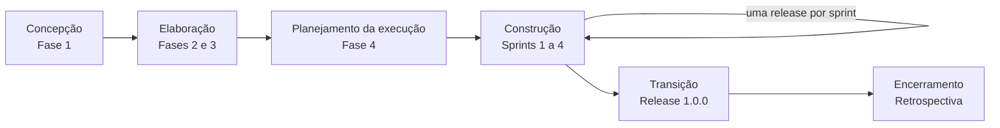
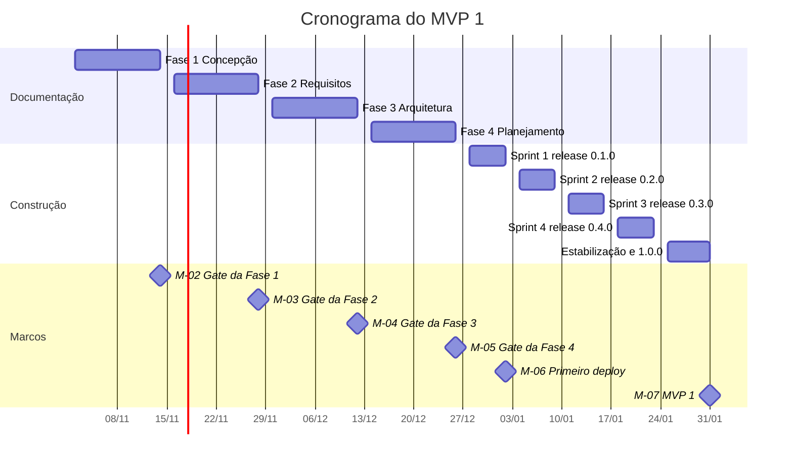

# Plano do Projeto

| Campo     | Valor            |
| --------- | ---------------- |
| Projeto   | Root Book        |
| Documento | Plano do Projeto |
| Versão    | 0.2              |
| Data      | 12/11/2026       |
| Autor     | Samuel           |
| Status    | Rascunho         |

## Histórico de revisões

| Versão | Data       | Autor  | Descrição                                                                                               |
| ------ | ---------- | ------ | ------------------------------------------------------------------------------------------------------- |
| 0.1    | 12/11/2026 | Samuel | Versão inicial.                                                                                         |
| 0.2    | 12/11/2026 | Samuel | Ajuste das datas do cronograma com adição de uma semana a cada fase e entrega do MVP 1 até 31/01/2027.  |

---

## 1. Propósito

Este plano define como o MVP 1 será conduzido do planejamento à entrega: modelo de ciclo de vida, metodologia, fases e critérios de saída, horas, cronograma, releases, ambientes, instância de demonstração, gestão de configuração, ferramentas e gestão de riscos e de mudanças.

---

## 2. Modelo de ciclo de vida

O projeto adota um ciclo de vida **iterativo e incremental**, organizado nas fases do RUP:

Justificativa:

- As capacidades da Visão do Produto são hipóteses; a Fase 2 precisa validá-las antes que a arquitetura seja definida.
- O principal risco técnico, a seleção de intervalos no calendário, é tratado por prova de conceito na Elaboração, antes da Construção.
- Uma release por sprint mantém uma versão publicada a cada semana, o que reduz o efeito dos riscos de escopo (RSK-01) e de interrupção (RSK-14).
- Os documentos das Fases 5 a 8 (desenvolvimento, qualidade, implantação e operação) são produzidos ao longo das sprints, e não em bloco.

---

## 3. Metodologia

### 3.1 Scrum solo

| Elemento               | Definição                                                                             |
| ---------------------- | ------------------------------------------------------------------------------------- |
| Duração da sprint      | 1 semana, de segunda a sábado                                                         |
| Capacidade por sprint  | 30 h, das quais 1,5 h em cerimônias                                                   |
| Limite de WIP          | No máximo 2 itens em "Em andamento"                                                   |
| Quadro                 | GitHub Projects, com as colunas Backlog, Pronto, Em andamento, Em revisão e Concluído |
| Entrada em "Pronto"    | Item atende à Definition of Ready                                                     |
| Entrada em "Concluído" | Item atende à Definition of Done                                                      |

### 3.2 Cerimônias adaptadas

| Cerimônia              | Momento                      | Duração | Saída                                                                                    |
| ---------------------- | ---------------------------- | ------- | ---------------------------------------------------------------------------------------- |
| Planejamento da sprint | Segunda-feira, início do dia | 30 min  | Meta da sprint e itens selecionados no GitHub Projects                                   |
| Registro diário        | Fim de cada dia de trabalho  | 10 min  | Entrada no devlog: o que foi feito, bloqueios e horas trabalhadas                        |
| Refinamento            | Quinta-feira                 | 15 min  | Itens da sprint seguinte atendendo à Definition of Ready                                 |
| Sprint review          | Sábado                       | 30 min  | Demonstração gravada (GIF ou vídeo curto), release notes e revisão do registro de riscos |
| Retrospectiva          | Sábado, após a review        | 15 min  | Registro em `docs/sprints/` no formato manter, melhorar e experimentar                   |

### 3.3 Separação dos papéis

- O PR é revisado no dia útil seguinte à abertura, com o checklist do template, e os achados são registrados como comentários no próprio PR.
- Sessões de teste exploratório são feitas em dia diferente daquele em que o item foi desenvolvido.
- A correspondência entre papéis e evidências está no [registro de stakeholders](02-registro-de-stakeholders.md#5-separação-dos-papéis-do-autor).

---

## 4. Fases do SDLC e critérios de saída

| Fase                        | Período                 | Horas            | Entregáveis principais                                                                                                     | Critério de saída                                                                          | Tag de baseline      |
| --------------------------- | ----------------------- | ---------------- | -------------------------------------------------------------------------------------------------------------------------- | ------------------------------------------------------------------------------------------ | -------------------- |
| 1. Concepção                | 02/11 a 14/11/2026      | 30               | Documentos de `docs/01-concepcao/` e `docs/processo/`                                                                      | Gate da Fase 1 aprovado                                                                    | `concepcao-v1.0`     |
| 2. Requisitos               | 16/11 a 28/11/2026      | 30               | Plano de elicitação, registros de elicitação, SRS, histórias de usuário, matriz de rastreabilidade, relatório de validação | SRS validada por inspeção e priorizada por MoSCoW                                          | `req-baseline-v1.0`  |
| 3. Arquitetura              | 30/11 a 12/12/2026      | 30               | Diagramas C4, ADRs, modelo de dados, contrato OpenAPI, modelagem de ameaças STRIDE, prova de conceito                      | ADRs aceitos para as decisões estruturais; contrato OpenAPI cobrindo as capacidades *Must* | `arq-baseline-v1.0`  |
| 4. Planejamento da execução | 14/12 a 26/12/2026      | 30               | Backlog em issues, plano de releases revisado, Definition of Ready e Definition of Done, plano de testes                   | Itens da Sprint 1 atendendo à Definition of Ready                                          | `plan-baseline-v1.0` |
| 5. Desenvolvimento          | 28/12/2026 a 31/01/2027 | Nas sprints      | Código, PRs revisados, devlog                                                                                              | Itens atendendo à Definition of Done                                                       | Tags de release      |
| 6. Qualidade e testes       | 28/12/2026 a 31/01/2027 | Nas sprints      | Plano de testes, suítes automatizadas, relatórios de sessões exploratórias, avaliação heurística                           | Critérios de saída do plano de testes atendidos na 1.0.0                                   | Tags de release      |
| 7. Implantação              | A partir da Sprint 1    | Nas sprints      | Pipeline de CI/CD, instância de demonstração, instruções de execução, termos de uso e política de privacidade              | Release 1.0.0 publicada pelo pipeline                                                      | `v1.0.0`             |
| 8. Operação                 | A partir da Sprint 1    | Nas sprints      | Runbook e monitoramento da demonstração                                                                                    | Rollback e reinício manual dos dados executados ao menos uma vez                           |                      |
| 9. Encerramento             | 31/01/2027              | Na estabilização | Retrospectiva do MVP 1 e estudo de caso                                                                                    | Retrospectiva publicada                                                                    |                      |

---

## 5. Orçamento de horas

Disponibilidade de 30 horas semanais, de segunda a sábado (5 horas por dia). Os feriados estão incluídos como dias de trabalho; a análise está no [estudo de viabilidade](03-estudo-de-viabilidade.md#43-feriados).

| Período                 | Atividade                                    | Horas   |
| ----------------------- | -------------------------------------------- | ------- |
| 02/11 a 14/11/2026      | Fase 1                                       | 30      |
| 16/11 a 28/11/2026      | Fase 2                                       | 30      |
| 30/11 a 12/12/2026      | Fase 3                                       | 30      |
| 14/12 a 26/12/2026      | Fase 4                                       | 30      |
| 28/12/2026 a 02/01/2027 | Sprint 1                                     | 30      |
| 04/01 a 09/01/2027      | Sprint 2                                     | 30      |
| 11/01 a 16/01/2027      | Sprint 3                                     | 30      |
| 18/01 a 23/01/2027      | Sprint 4                                     | 30      |
| 25/01 a 31/01/2027      | Estabilização, release 1.0.0 e retrospectiva | 20      |
| **Total**               |                                              | **260** |

As horas trabalhadas são registradas diariamente no devlog e comparadas com as planejadas na sprint review.

---

## 6. Cronograma macro

---

## 7. Plano de releases

Cada sprint termina com uma release publicada na instância de demonstração. O conteúdo de cada release é definido na Fase 4, após a priorização MoSCoW; a tabela abaixo é a proposta inicial.

| Versão | Etapa         | Data       | Conteúdo previsto                                                                                                       |
| ------ | ------------- | ---------- | ----------------------------------------------------------------------------------------------------------------------- |
| 0.1.0  | Sprint 1      | 02/01/2027 | Fundação: monorepo, CI, Docker Compose e aplicação mínima publicada na demonstração, com `/health`                      |
| 0.2.0  | Sprint 2      | 09/01/2027 | Autenticação, autorização e modo demonstração, publicados juntos para que o cadastro nunca fique aberto na demonstração |
| 0.3.0  | Sprint 3      | 16/01/2027 | Consentimento e exclusão da conta, Espaços, tarefas, fuso horário e validação                                           |
| 0.4.0  | Sprint 4      | 23/01/2027 | Calendário, eventos, seleção de horário livre, paleta de comandos e reserva de blocos                                   |
| 1.0.0  | Estabilização | 31/01/2027 | Logs, correções, testes de ponta a ponta, instruções de execução, termos de uso e política de privacidade               |

A distribuição segue as estimativas do [estudo de viabilidade](03-estudo-de-viabilidade.md#44-esforço-do-mvp-1), com cerca de 28 h de itens por sprint.

Versionamento semântico; a release 1.0.0 recebe o título "MVP 1" no GitHub.

---

## 8. Ambientes

| Ambiente              | Finalidade                                                         | Infraestrutura                                  | Dados                              | Deploy                        |
| --------------------- | ------------------------------------------------------------------ | ----------------------------------------------- | ---------------------------------- | ----------------------------- |
| Desenvolvimento local | Desenvolvimento e testes manuais                                   | Docker Compose com PostgreSQL e Mailpit         | Seed de desenvolvimento            | Manual                        |
| Integração contínua   | Lint, testes e build a cada PR                                     | GitHub Actions; PostgreSQL por Testcontainers   | Efêmeros, criados pelos testes     | Automático em cada PR         |
| Demonstração          | Avaliação pública; funciona como ambiente de produção do portfólio | Vercel (front-end), Render (API) e Neon (banco) | Fictícios, reiniciados diariamente | Automático a partir da `main` |

Não há ambiente de homologação. Com planos gratuitos, um segundo ambiente dobraria o consumo de cotas e o esforço de operação; o risco é compensado pelos testes automatizados executados antes de qualquer merge na `main`.

---

## 9. Instância de demonstração

Os serviços são uma proposta, a confirmar por ADR na Fase 3. As capacidades do modo demonstração estão na CAP-54 da [Visão do Produto](01-visao-do-produto-mvp1.md#mod-16-demonstração).

### 9.1 Etapas

| Etapa                      | Descrição                                                                                                                                                                                                                                           | Quando           |
| -------------------------- | --------------------------------------------------------------------------------------------------------------------------------------------------------------------------------------------------------------------------------------------------- | ---------------- |
| 1. Banco                   | Projeto `root-book-demo` no Neon Free, região AWS US East (N. Virginia). A aplicação usa a string de conexão *pooled*; as migrações usam a string *direct*.                                                                                         | Sprint 1         |
| 2. API                     | Web Service no Render Free, região Virginia, na mesma região do banco. Migrações executadas no comando de start, porque o plano gratuito não oferece *pre-deploy*. A API escuta a porta da variável `PORT` e expõe `/health` sem consultar o banco. | Sprint 1         |
| 3. Front-end               | Projeto na Vercel Hobby. O Next.js encaminha `/api` para a API por *rewrites*, mantendo origem única.                                                                                                                                               | Sprint 1         |
| 4. Modo demonstração       | Com `DEMO_MODE=true`, a API bloqueia cadastro, recuperação de senha, troca de senha e exclusão da conta; a interface oculta essas ações e exibe as credenciais da conta de exemplo e o aviso de reinício diário.                                    | Sprint 2         |
| 5. Dados                   | Seed que recria a conta de exemplo com datas relativas ao dia da execução, executado diariamente por workflow do GitHub Actions.                                                                                                                    | Sprint 2         |
| 6. Inicialização           | Antes da entrada na conta, o front-end consulta `/health` e, se a resposta demorar, informa que o servidor está iniciando.                                                                                                                          | Sprint 2         |
| 7. *Keep-alive* (opcional) | Workflow que chama `/health` a cada 14 minutos, decidido após medir o tempo de inicialização.                                                                                                                                                       | Estabilização    |
| 8. Documentação            | ADR de hospedagem, runbook e README.                                                                                                                                                                                                                | Fase 3 e sprints |

### 9.2 Variáveis de ambiente da API

| Variável       | Conteúdo                                             |
| -------------- | ---------------------------------------------------- |
| `DATABASE_URL` | String de conexão *pooled* do Neon                   |
| `DIRECT_URL`   | String de conexão *direct* do Neon, para migrações   |
| `JWT_SECRET`   | Valor aleatório gerado para a instância              |
| `DEMO_MODE`    | `true` na demonstração; `false` nas demais execuções |

### 9.3 Rotina de reinício

| Item            | Definição                                               |
| --------------- | ------------------------------------------------------- |
| Arquivo         | `.github/workflows/demo-reset.yml`                      |
| Agendamento     | Diário às 06:00 UTC (03:00 em Brasília)                 |
| Execução manual | Habilitada por `workflow_dispatch`                      |
| Segredo         | `DEMO_DIRECT_URL`, no environment `demo` do repositório |

O GitHub desativa agendamentos em repositórios públicos após 60 dias sem atividade; nesse caso, o workflow é reativado conforme o runbook (RSK-09).

### 9.4 Regras de uso

- Não cadastrar meio de pagamento nos fornecedores, para que o excesso de uso resulte em suspensão e não em cobrança.
- Manter no máximo um serviço do Render ativo continuamente; o banco não é mantido ativo (RSK-07).
- A conta de exemplo usa e-mail do domínio reservado `example.com`.

---

## 10. Artefatos previstos para as fases seguintes

| Artefato                                              | Fase  | Conteúdo esperado                                                                       | Status   |
| ----------------------------------------------------- | ----- | --------------------------------------------------------------------------------------- | -------- |
| Plano e registros de elicitação                       | 2     | Técnicas, fontes, timebox e achados                                                     | Pendente |
| SRS, histórias de usuário e matriz de rastreabilidade | 2     | Requisitos validados e priorizados, com origem nas CAP-xx ou nas técnicas de elicitação | Pendente |
| ADR de hospedagem da demonstração                     | 3     | Vercel, Render e Neon, limites e alternativas consideradas                              | Pendente |
| ADR de autenticação                                   | 3     | Armazenamento, expiração e revogação do JWT                                             | Pendente |
| ADR da biblioteca de calendário                       | 3     | Resultado da prova de conceito de seleção de intervalos                                 | Pendente |
| Workflow de reinício e seed                           | 5 e 7 | `.github/workflows/demo-reset.yml` e seed com datas relativas                           | Pendente |
| Instruções de execução                                | 7     | Docker Compose, `.env.example` e rotina de backup                                       | Pendente |
| Termos de uso e política de privacidade               | 7     | Documentos exigidos pela CAP-05, incluindo o tratamento na demonstração                 | Pendente |
| Runbook                                               | 8     | Deploy, rollback, reinício manual dos dados e reativação do agendamento                 | Pendente |
| Atualização do README da raiz                         | 7     | Link da demonstração, credenciais da conta de exemplo e avisos                          | Pendente |
| Retrospectiva do MVP 1 e estudo de caso               | 9     | Planejado e realizado, métricas e lições aprendidas                                     | Pendente |

---

## 11. Gestão de configuração

### 11.1 Repositório e branches

- Repositório público `root_book` no GitHub.
- GitHub Flow: a branch `main` é protegida por ruleset e recebe alterações apenas por PR.
- Branches de trabalho no formato `tipo/numero-da-issue-descricao`, por exemplo `docs/4-visao-do-produto`.
- Merge por *squash*, com o título do PR no padrão Conventional Commits.

### 11.2 Commits e versões

- Mensagens no padrão Conventional Commits (`feat`, `fix`, `docs`, `test`, `refactor`, `chore`, `ci`), verificadas pelo commitlint.
- Versionamento semântico: versões 0.x durante a construção; 1.0.0 para o MVP 1.
- CHANGELOG gerado a partir dos commits; a ferramenta será definida na Fase 4.

### 11.3 Baselines

| Tag                  | Momento            |
| -------------------- | ------------------ |
| `concepcao-v1.0`     | Gate da Fase 1     |
| `req-baseline-v1.0`  | Gate da Fase 2     |
| `arq-baseline-v1.0`  | Gate da Fase 3     |
| `plan-baseline-v1.0` | Gate da Fase 4     |
| `v0.1.0` a `v0.4.0`  | Fim de cada sprint |
| `v1.0.0`             | Entrega do MVP 1   |

As tags são protegidas contra atualização e exclusão pelo ruleset `baselines`.

### 11.4 Documentação

A estrutura de `docs/`, os nomes de arquivo e o formato dos documentos seguem o [padrão de documentos](../processo/01-padrao-de-documentos.md). A aprovação segue o [procedimento de aprovação de documentos](../processo/02-aprovacao-de-documentos.md).

### 11.5 Segredos

- Segredos nunca são versionados. O arquivo `.env` fica no `.gitignore`; o `.env.example`, sem valores, é versionado.
- No CI, segredos ficam nos segredos do GitHub; na demonstração, nas variáveis de ambiente dos painéis da Vercel e do Render.
- Secret scanning e push protection ficam ligados no repositório.
- Em caso de suspeita de exposição, o segredo é revogado e substituído imediatamente (RSK-11).

---

## 12. Definition of Ready e Definition of Done

Proposta inicial, a confirmar na Fase 4.

**Definition of Ready.** Um item pode entrar em "Pronto" quando:

- está ligado a um requisito da SRS;
- tem critérios de aceite escritos em Gherkin;
- tem estimativa de no máximo 6 h (itens maiores são divididos);
- não depende de item não concluído;
- as decisões de arquitetura necessárias estão registradas em ADR.

**Definition of Done.** Um item pode entrar em "Concluído" quando:

- os critérios de aceite são atendidos;
- os testes automatizados do item foram escritos e passam no CI;
- o PR foi revisado com o checklist, em dia diferente da abertura;
- a documentação afetada e a matriz de rastreabilidade foram atualizadas;
- a alteração está publicada na instância de demonstração.

---

## 13. Ferramentas

| Finalidade                 | Ferramenta                                             | Situação |
| -------------------------- | ------------------------------------------------------ | -------- |
| Linguagem                  | TypeScript                                             | Definida |
| Front-end                  | Next.js                                                | Definida |
| API                        | NestJS, Zod, JWT                                       | Definida |
| Dados                      | PostgreSQL, Prisma ORM                                 | Definida |
| Testes                     | Vitest, Testcontainers                                 | Definida |
| Compilação                 | SWC                                                    | Definida |
| Interface                  | Tailwind CSS, shadcn/ui, FullCalendar (recursos MIT)   | Proposta |
| API complementar           | @nestjs/swagger, Passport JWT, Argon2, Pino            | Proposta |
| Datas                      | date-fns-tz                                            | Proposta |
| Monorepo                   | pnpm workspaces, Turborepo                             | Proposta |
| Qualidade de código        | ESLint, Prettier, Husky, lint-staged, commitlint       | Proposta |
| Testes complementares      | Playwright, axe-core, k6                               | Proposta |
| Segurança                  | Dependabot, CodeQL, secret scanning                    | Proposta |
| Execução local             | Docker Compose, Mailpit                                | Proposta |
| Código, gestão e CI/CD     | GitHub, GitHub Issues, GitHub Projects, GitHub Actions | Definida |
| Protótipos                 | Figma (plano gratuito)                                 | Proposta |
| Diagramas                  | Mermaid                                                | Definida |
| Hospedagem da demonstração | Vercel Hobby, Render Free, Neon Free                   | Proposta |

As ferramentas propostas são confirmadas por ADR na Fase 3.

---

## 14. Gestão de riscos

- O [registro de riscos](04-registro-de-riscos.md) é revisado em cada sprint review e em cada gate de fase.
- Os gatilhos de cada risco são verificados na revisão; quando um gatilho é atingido, a resposta planejada é executada.
- Novos riscos são registrados como issues com o label `risco`.

---

## 15. Gestão de mudanças

- **Antes da baseline de uma fase**, os documentos podem ser alterados livremente, com registro no histórico de revisões.
- **Depois da baseline**, toda alteração passa por uma issue com o label `change-request`, contendo descrição, justificativa, impacto (escopo, horas, riscos e documentos), decisão e data.
- Uma mudança aprovada atualiza a SRS, a matriz de rastreabilidade, o backlog e a versão dos documentos afetados.
- A Visão do Produto não é alterada após o congelamento; as mudanças de requisitos são registradas na SRS.
- Mudanças nos marcos M-05 e M-07 exigem aprovação do patrocinador, conforme o [termo de abertura](05-termo-de-abertura.md#1-identificação).
